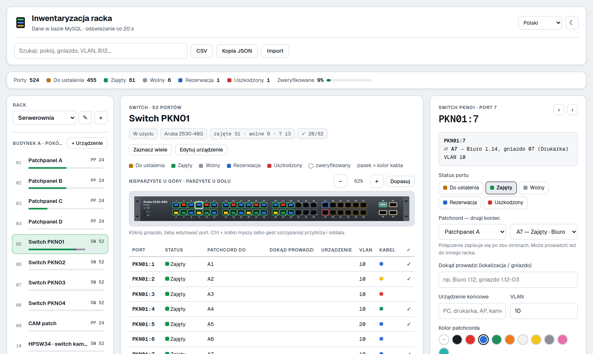
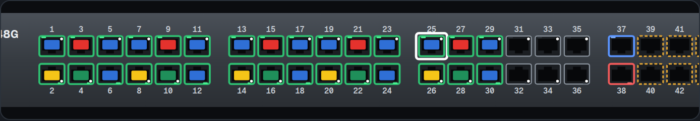
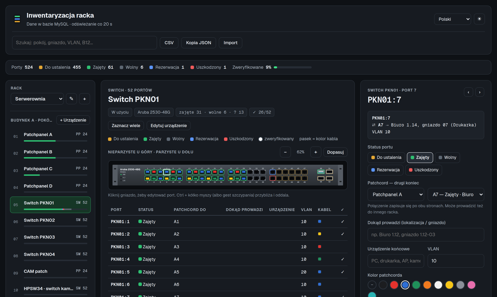
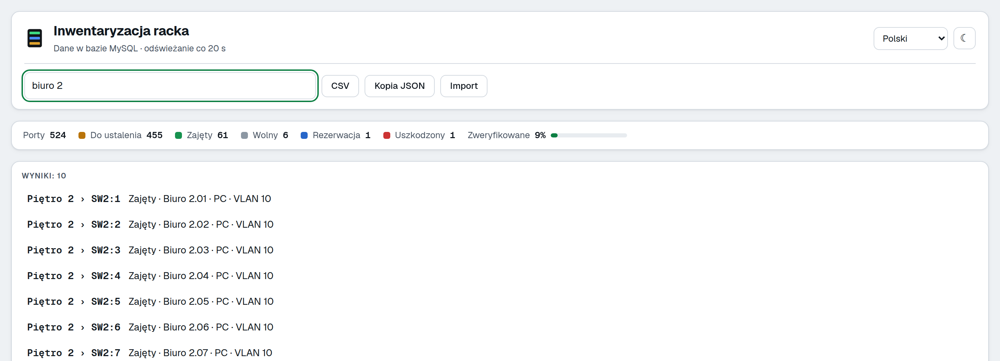
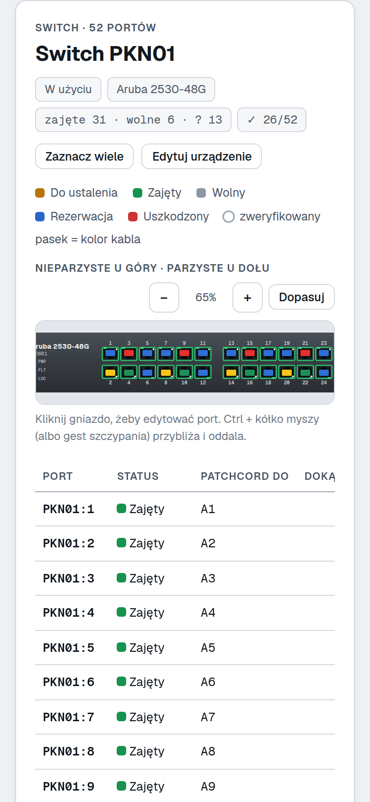
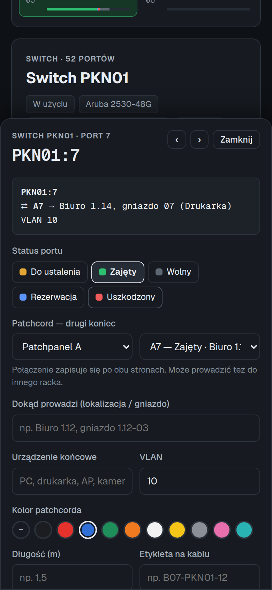
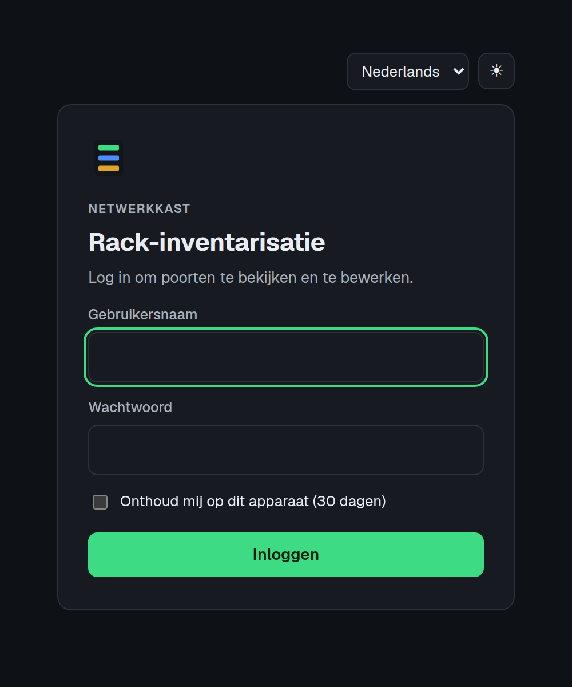

# Rack Inventory

Aplikacja webowa do inwentaryzacji szaf sieciowych. Dla każdego portu patchpaneli i switchy zapisujesz:
- status portu,
- patchcord z drugim końcem,
- dokąd prowadzi kabel i jakie urządzenie jest na końcu,
- VLAN, kolor, długość i etykietę kabla,
- plan po przebudowie i notatki.

Dane trzymane są w MySQL/MariaDB, a każda zmiana portu trafia do historii.

## Instalacja na Proxmox VE

Jedno polecenie w powłoce węzła Proxmox (**Datacenter → węzeł → Shell** albo SSH jako root) tworzy kontener LXC z Debianem 12 i gotową, działającą aplikacją:

```bash
bash -c "$(wget -qLO - https://raw.githubusercontent.com/grubassound/inwent/main/proxmox/rack-inventory.sh)"
```

Skrypt najpierw pyta, czy użyć ustawień domyślnych (1 rdzeń, 1 GB RAM, dysk 4 GB, sieć `vmbr0` z DHCP). Po wybraniu **Nie** możesz podać własne: ID i nazwę kontenera, zasoby, stały adres IP, bramę, VLAN oraz login i hasło do aplikacji.

Potem skrypt:
1. pobiera szablon Debiana 12 i tworzy kontener nieuprzywilejowany (z autostartem razem z Proxmoxem),
2. instaluje w nim Node.js 22, MariaDB i Apache,
3. pobiera aplikację z GitHuba i tworzy bazę z losowym hasłem,
4. zapisuje `.env`, uruchamia usługę i włącza HTTPS z własnym certyfikatem (HTTP przekierowuje na HTTPS),
5. ustawia codzienną kopię bazy i sprawdza, czy aplikacja odpowiada.

Instalacja trwa kilka minut. Na końcu skrypt wypisuje adres, np. `https://192.168.1.77/`.

**Domyślne logowanie: `admin` / `adminadmin`.** To hasło jest jawne w tym repozytorium, więc zmień je od razu po instalacji:

```bash
pct enter <ID kontenera>
rack-inventory passwd
```

Polecenia w kontenerze:

| Polecenie | Co robi |
|---|---|
| `rack-inventory update` | Kopia bazy, pobranie nowej wersji z GitHuba, restart |
| `rack-inventory passwd` | Zmiana loginu i hasła (wylogowuje wszystkich) |
| `rack-inventory backup` | Kopia bazy teraz (do `/opt/rack-inventory/backups`) |
| `rack-inventory status` | Stan usługi i adres aplikacji |

Z węzła Proxmox wywołasz je bez wchodzenia do kontenera, np. `pct exec 105 -- rack-inventory update`.

Na zwykłym serwerze z Debianem 12, bez Proxmoxa, ten sam instalator uruchomisz jako root:

```bash
bash -c "$(curl -fsSL https://raw.githubusercontent.com/grubassound/inwent/main/proxmox/ct-install.sh)"
```

Inne sposoby: [instalator `install.sh`](#szybka-instalacja) na dowolnym serwerze z Debianem lub Ubuntu, z pytaniami o każde ustawienie, albo [instalacja ręczna](#instalacja-ręczna) krok po kroku.

---

## Jak to wygląda



**Przedni panel switcha w stylu Aruba.** Kolor ramki pokazuje status portu, a wtyczka kolor kabla. Panel można przybliżać i oddalać.



**Motyw ciemny.** Przełączasz go jednym kliknięciem (☀/☾).



**Wyszukiwarka** przeszukuje wszystkie racki. Kliknięcie wyniku otwiera właściwy rack i port.



<table>
<tr>
<td align="center" width="33%"><br><b>Na telefonie</b><br>panel switcha i lista portów</td>
<td align="center" width="33%"><br><b>Karta portu</b><br>wysuwa się od dołu ekranu</td>
<td align="center" width="33%"><br><b>4 języki</b><br>PL · EN · NL · CS, tu logowanie po holendersku</td>
</tr>
</table>

**Stack:** Node.js 18+ · Express · MySQL 8 / MariaDB 10.5+. Frontend to czysty HTML, CSS i JavaScript, bez kompilacji i bez frameworków.

---

## Spis treści

**Start**
1. [Instalacja na Proxmox VE (jedna linia)](#instalacja-na-proxmox-ve)

**Dla użytkownika**

2. [Co potrafi](#co-potrafi)
3. [Jak pracować przy szafie](#jak-pracować-przy-szafie)

**Dla administratora**

4. [Jak to działa na serwerze](#jak-to-działa-na-serwerze)
5. [Wymagania](#wymagania)
6. [Szybka instalacja (install.sh)](#szybka-instalacja)
7. [Instalacja ręczna](#instalacja-ręczna)
8. [Konfiguracja (.env)](#konfiguracja-env)
9. [Apache, nginx i HTTPS](#apache-nginx-i-https)
10. [Logowanie](#logowanie)
11. [Kopie zapasowe](#kopie-zapasowe)
12. [Aktualizacja](#aktualizacja)
13. [Import danych z wersji w Claude](#import-danych-z-wersji-w-claude)
14. [Rozwiązywanie problemów](#rozwiązywanie-problemów)

**Dla programisty**

15. [Struktura projektu](#struktura-projektu)
16. [Baza danych](#baza-danych)
17. [API](#api)
18. [Tłumaczenia](#tłumaczenia)
19. [Testy](#testy)

---

## Co potrafi

### Szafy i urządzenia
- **Wiele racków.** Przełączasz je listą nad szafą. Przyciskiem **+** dodajesz nowy rack, a przyciskiem **✎** edytujesz bieżący (nazwa, lokalizacja, notatki, kolejność na liście). Aplikacja pamięta ostatnio oglądany rack.
- **Widok szafy** od góry do dołu, z paskiem zajętości każdego urządzenia.
- **Przedni panel switcha w stylu Aruba:**
  - obudowa 1U z diodami stanu,
  - gniazda RJ45 w blokach po 12 (nieparzyste u góry, parzyste u dołu) i moduły SFP po prawej,
  - zajęty port ma wtyczkę w kolorze kabla.

  Kliknięcie gniazda otwiera kartę portu.
- **Przybliżanie panelu:** przyciski **−**, **+** i **Dopasuj**, a także **Ctrl + kółko myszy** albo gest szczypania na touchpadzie. Powiększenie zostaje zapamiętane.
- **Szablony modeli Aruba** (2530, 2540, 2930F, CX 6100, Instant On 1930) w formularzu urządzenia. Szablon wypełnia model oraz liczbę portów i modułów SFP.
- **Patchpanele i panele światłowodowe** mają porty w modułach po 6.
- **Grafika szafy** w lewej kolumnie: realistyczny widok całej szafy z urządzeniami, portami w kolorach kabli i migającymi diodami. Kliknięcie urządzenia je otwiera. Przełącznik **Grafika / Lista** wraca do zwykłej listy.
- **Rysunek techniczny szafy** (przycisk 📐): widok z przodu z numeracją U, wymiarami 19″ i wysokością w mm, wykaz urządzeń i tabliczka rysunkowa. Pobierzesz go jako **SVG** albo wydrukujesz i zapiszesz jako **PDF** (A4 poziomo). Grafikę szafy pobierzesz jako **PNG**. Wysokość szafy w U ustawiasz w edycji racka (0 = tyle, ile urządzeń).
- **Animacje:** diody zajętych portów świecą i migają jak przy ruchu sieciowym, a wybrany port pulsuje. Przy systemowym ustawieniu „ogranicz ruch” animacje są wyłączone.
- **Przenoszenie urządzenia do innego racka:** w edycji urządzenia, w polu **Rack**.

### Porty i patchcordy
- **Statusy portów:** do ustalenia, zajęty, wolny, rezerwacja, uszkodzony. Dodatkowo znacznik **zweryfikowany fizycznie**.
- **Patchcord zapisuje się po obu stronach naraz.**
  - Przepięcie zwalnia stary koniec: port „Zajęty” wraca wtedy do „Do ustalenia”, żeby ktoś go sprawdził.
  - Kolor, długość i etykieta kabla są wspólne dla obu końców.
- **Patchcordy między rackami:** etykieta drugiego końca ma wtedy nazwę racka, np. `Serwerownia › A5`.
- **Trasa kabla** w karcie portu, np. `PKN01:12 ⇄ B7 → Biuro 1.12, gniazdo 3 (Drukarka)`.
- **Zapisz i dalej ›** oraz strzałki **← →** pozwalają przechodzić port po porcie.
- **Zaznaczanie wielu portów** i hurtowa zmiana statusu. Hurtowe „Wolny” odpina patchcordy z zaznaczonych portów.
- **Historia zmian** każdego portu: kto, kiedy i co zmienił.

### Praca w kilka osób
- **Automatyczne odświeżanie co 20 s.** Zmiany wprowadzone na telefonie przy szafie widać na komputerze w biurze.
- **Ochrona przed nadpisaniem:** gdy dwie osoby edytują ten sam port, druga widzi ostrzeżenie z aktualnym stanem z bazy i sama decyduje, czy zapisać swoją wersję.
- **Pytanie o niezapisane zmiany** przed przejściem do innego portu.

### Interfejs
- **Cztery języki:** polski, angielski, holenderski i czeski. Na start aplikacja wybiera język przeglądarki, a wybór zostaje zapamiętany na urządzeniu.
- **Motyw jasny i ciemny:** przełącznik ☀/☾ w nagłówku. Dopóki nie wybierzesz, obowiązuje motyw systemu.
- **Działa na telefonie.** Karta portu wysuwa się wtedy od dołu.
- **Wyszukiwarka** po pokoju, gnieździe, VLAN-ie, etykiecie, kolorze i notatkach we wszystkich rackach. Kliknięcie wyniku otwiera właściwy rack i port.

### Dane
- **Eksport CSV** (otwiera się w Excelu) w języku interfejsu.
- **Kopia JSON** całej bazy oraz **import** takiej kopii.
- **Logowanie** przez stronę logowania, z opcją „Zapamiętaj mnie”.

---

## Jak pracować przy szafie

1. Otwórz aplikację na telefonie. Wybierz rack z listy u góry panelu szafy, a potem urządzenie.
2. Kliknij port. Na switchu kliknij gniazdo na panelu przednim. Jeśli gniazda są za małe, przybliż panel przyciskiem **+**.
3. Ustaw status. W polu **Patchcord — drugi koniec** wybierz urządzenie i port po drugiej stronie kabla, np. Patchpanel B, port 7. Drugi koniec uzupełni się sam.
4. Na patchpanelu wpisz **Dokąd prowadzi**, np. pokój i numer gniazda w ścianie, oraz **Urządzenie końcowe**.
5. Wybierz kolor kabla i wpisz długość. Gdy kabel jest przetestowany, zaznacz **Zweryfikowany fizycznie**.
6. **Zapisz i dalej ›** przechodzi od razu do kolejnego portu.
7. Puste gniazda oznaczaj hurtem: **Zaznacz wiele** → zaznacz porty → **Wolny**.
8. Pole **Plan po przebudowie** opisuje, gdzie port ma trafić po porządkowaniu szafy.

Etykiety portów:
- patchpanele z jednoliterowym prefiksem: `A1…A24`, `B1…`
- z dłuższym prefiksem: `CAM-1…`
- switche: `PKN01:1…PKN01:52` (49–52 to SFP)

Prefiks ustawiasz w edycji urządzenia.

---

## Jak to działa na serwerze

Aplikacja to mały serwer Node.js. Działa w tle jako usługa systemd i nasłuchuje tylko lokalnie (`127.0.0.1:3080`). Z sieci łączysz się przez **Apache** albo nginx. Serwer WWW odbiera ruch na portach 80 i 443, obsługuje HTTPS i przekazuje zapytania do Node.js. Ten sam Apache może jednocześnie obsługiwać inne strony, np. w PHP.

```
przeglądarka ──► Apache :80/:443 ──► Node.js 127.0.0.1:3080 ──► MySQL/MariaDB
                    └──► inne strony (PHP, statyczne…)
```

Przy starcie aplikacja sama tworzy brakujące tabele i aktualizuje strukturę bazy (`src/migrate.js`).

---

## Wymagania

- **Linux:** Ubuntu albo Debian. Na innych dystrybucjach aplikacja też działa, tylko `install.sh` zakłada `apt` i systemd.
- **Node.js 18 lub nowszy.** Sprawdź poleceniem `node -v`. Instalacja Node 22 LTS:
  ```bash
  curl -fsSL https://deb.nodesource.com/setup_22.x | sudo -E bash -
  sudo apt install -y nodejs
  ```
- **MySQL 8 albo MariaDB 10.5+.**
- **Apache 2.4** (albo nginx) jako serwer WWW przed aplikacją. Bez niego aplikacja też działa, ale tylko pod `http://IP:3080` i bez HTTPS.
- **git**

> Nie masz jeszcze serwera WWW? Instalacja Apache, PHP, MariaDB, HTTPS i dodatków od zera na Ubuntu/Debian jest opisana w **[docs/serwer-www-linux.md](docs/serwer-www-linux.md)**.

---

## Szybka instalacja

```bash
sudo mkdir -p /opt/rack-inventory && sudo chown "$USER": /opt/rack-inventory
git clone https://github.com/grubassound/inwent.git /opt/rack-inventory
cd /opt/rack-inventory
bash install.sh
```

Instalator po kolei:

1. Sprawdza wersję Node.js i instaluje zależności (`npm install --omit=dev`).
2. Pyta o dane bazy. Jeśli MySQL działa na tym samym serwerze, może **sam założyć bazę i użytkownika** (przez `sudo mysql`) z losowym hasłem.
3. Pyta o adres i port aplikacji oraz opcjonalny login i hasło. Zapisuje `.env` z uprawnieniami 600 i losowym kluczem sesji.
4. Tworzy tabele i, jeśli chcesz, wczytuje układ szafy z inwentaryzacji (16 urządzeń).
5. Instaluje i uruchamia usługę systemd `rack-inventory`.

Na pytanie o adres nasłuchu zostaw `127.0.0.1`, jeśli aplikacja ma działać za Apache. Potem skonfiguruj Apache według sekcji [Apache, nginx i HTTPS](#apache-nginx-i-https).

---

## Instalacja ręczna

### 1. Baza i użytkownik

```bash
sudo mysql
```
```sql
CREATE DATABASE rack_inventory CHARACTER SET utf8mb4 COLLATE utf8mb4_unicode_ci;
CREATE USER 'rack'@'localhost' IDENTIFIED BY 'TWOJE_MOCNE_HASLO';
GRANT ALL PRIVILEGES ON rack_inventory.* TO 'rack'@'localhost';
FLUSH PRIVILEGES;
EXIT;
```

Jeśli baza stoi na innym serwerze, zamiast `'rack'@'localhost'` podaj IP serwera aplikacji. Upewnij się też, że MySQL nasłuchuje w sieci (`bind-address`).

### 2. Kod i zależności

```bash
sudo mkdir -p /opt/rack-inventory && sudo chown "$USER": /opt/rack-inventory
git clone https://github.com/grubassound/inwent.git /opt/rack-inventory
cd /opt/rack-inventory
npm install --omit=dev
```

### 3. Konfiguracja

```bash
cp .env.example .env
chmod 600 .env
nano .env
```

Wszystkie zmienne są opisane w sekcji [Konfiguracja (.env)](#konfiguracja-env).

### 4. Tabele i układ szafy

```bash
npm run db:seed     # tabele + 16 urządzeń z inwentaryzacji (tylko gdy baza jest pusta)
# albo
npm run db:init     # same tabele; urządzenia dodasz w aplikacji
```

### 5. Próbne uruchomienie

```bash
npm start
# Rack Inventory działa na http://127.0.0.1:3080
curl http://127.0.0.1:3080/api/health   # {"ok":true}
```

Zatrzymasz je przez `Ctrl+C`.

### 6. Usługa systemd

```bash
sudo cp deploy/rack-inventory.service /etc/systemd/system/
sudo nano /etc/systemd/system/rack-inventory.service   # User, WorkingDirectory, ścieżka do node (which node)
sudo systemctl daemon-reload
sudo systemctl enable --now rack-inventory
sudo systemctl status rack-inventory
```

Logi aplikacji: `sudo journalctl -u rack-inventory -f`

---

## Konfiguracja (.env)

| Zmienna | Opis | Domyślnie |
|---|---|---|
| `HOST` | Adres nasłuchu: `127.0.0.1` za Apache/nginx, `0.0.0.0` dla całej sieci LAN bez serwera WWW | `127.0.0.1` |
| `PORT` | Port aplikacji | `3080` |
| `DB_HOST` / `DB_PORT` | Serwer bazy | `localhost` / `3306` |
| `DB_NAME` | Nazwa bazy | `rack_inventory` |
| `DB_USER` / `DB_PASSWORD` | Użytkownik i hasło bazy | `rack` / – |
| `DB_SOCKET` | Opcjonalnie gniazdo unix zamiast TCP, np. `/run/mysqld/mysqld.sock` | – |
| `AUTH_USER` / `AUTH_PASSWORD` | Login i hasło do aplikacji. Puste = logowanie wyłączone | – |
| `SESSION_SECRET` | Klucz podpisujący sesje (`openssl rand -hex 32`). Bez niego po każdym restarcie trzeba logować się ponownie | – |
| `HISTORY_DAYS` | Ile dni trzymać historię zmian portów. `0` = bez limitu | `0` |

Wartości ze znakami `#`, `$`, `` ` `` lub spacją wpisuj w apostrofach, np. `AUTH_PASSWORD='ab#c d'`. Po zmianie `.env` zrestartuj usługę: `sudo systemctl restart rack-inventory`.

---

## Apache, nginx i HTTPS

Najpierw sprawdź, czy aplikacja działa lokalnie: `curl http://127.0.0.1:3080/api/health` powinno zwrócić `{"ok":true}`. W `.env` zostaw `HOST=127.0.0.1`, żeby port 3080 nie był dostępny z sieci z pominięciem serwera WWW.

### Apache

Gotowa konfiguracja z komentarzami jest w [`deploy/apache.conf`](deploy/apache.conf). Najpierw jednorazowo włącz moduły:

```bash
sudo a2enmod proxy proxy_http headers
sudo systemctl restart apache2
```

**Wariant A: osobny adres**, np. `http://rack.firma.lan`. Wymaga wpisu w DNS albo w pliku `hosts` na komputerach w sieci.

```bash
sudo cp deploy/apache.conf /etc/apache2/sites-available/rack-inventory.conf
sudo nano /etc/apache2/sites-available/rack-inventory.conf   # ustaw ServerName
sudo a2ensite rack-inventory
sudo apache2ctl configtest            # ma wypisać: Syntax OK
sudo systemctl reload apache2
```

**Wariant B: podkatalog strony, która już działa**, np. `http://serwer/rack/`. Nie wymaga DNS, a reszta strony (np. PHP) działa jak dotąd. Dopisz do istniejącego `<VirtualHost>` (zwykle `000-default.conf`, a przy HTTPS także jego wersji SSL) przed `</VirtualHost>`:

```apache
RedirectMatch 301 ^/rack$ /rack/
<Location /rack/>
    ProxyPass        http://127.0.0.1:3080/ timeout=60
    ProxyPassReverse http://127.0.0.1:3080/
    LimitRequestBody 10485760
</Location>
```

Potem `sudo apache2ctl configtest && sudo systemctl reload apache2`. Końcowy ukośnik w `/rack/` jest ważny, bo frontend używa ścieżek względnych.

### HTTPS

- **Publiczna domena:** certyfikat Let's Encrypt, odnawia się sam.
  ```bash
  sudo apt install -y certbot python3-certbot-apache
  sudo certbot --apache -d rack.twojadomena.pl
  ```
- **Tylko sieć lokalna:** własny certyfikat (self-signed). Polecenia są w komentarzach w `deploy/apache.conf`. Przeglądarka przy pierwszym wejściu pokaże ostrzeżenie. Żeby zniknęło na stałe, zaimportuj certyfikat (`.crt`) na komputerach i telefonach jako zaufany.

Gdy włączone jest logowanie, używaj aplikacji **tylko przez HTTPS**. Inaczej hasło i ciasteczko sesji idą przez sieć otwartym tekstem.

### nginx

```bash
sudo cp deploy/nginx.conf /etc/nginx/sites-available/rack-inventory
sudo nano /etc/nginx/sites-available/rack-inventory      # ustaw server_name
sudo ln -s /etc/nginx/sites-available/rack-inventory /etc/nginx/sites-enabled/
sudo nginx -t && sudo systemctl reload nginx
```

HTTPS: `sudo apt install -y certbot python3-certbot-nginx && sudo certbot --nginx -d rack.twojadomena.pl`. Wariant z podkatalogiem jest w `deploy/nginx.conf`.

> Apache i nginx nie mogą jednocześnie nasłuchiwać na porcie 80. Na jednym serwerze używaj jednego z nich.

---

## Logowanie

Ustaw w `.env` i zrestartuj usługę:

```
AUTH_USER='admin'
AUTH_PASSWORD='mocne-haslo'
SESSION_SECRET='wynik polecenia: openssl rand -hex 32'
```

- Aplikacja pokazuje **stronę logowania**, z wyborem języka i motywu. W nagłówku jest przycisk **Wyloguj**.
- **Czas sesji:** 12 godzin, a z zaznaczonym **Zapamiętaj mnie** 30 dni na danym urządzeniu.
- Po **10 nieudanych próbach** z jednego adresu logowanie jest blokowane na 15 minut.
- **Zmiana hasła** albo `SESSION_SECRET` wylogowuje wszystkich.
- **Wygaśnięcie sesji w trakcie edycji portu** nie przenosi od razu na stronę logowania. Aplikacja pokazuje link do zalogowania w nowej karcie, żeby wpisane dane nie przepadły.
- **Skrypty** mogą korzystać z API przez HTTP Basic: `curl -u admin:hasło https://serwer/rack/api/state`.

---

## Kopie zapasowe

```bash
cd /opt/rack-inventory && bash backup.sh
```

Skrypt zapisuje zrzut bazy do `backups/rack_DATA.sql.gz` i trzyma 30 ostatnich plików. Kopie czyta tylko właściciel (uprawnienia 600), bo zawierają całą bazę.

Codzienna kopia o 2:15 (`crontab -e`):

```
15 2 * * * bash /opt/rack-inventory/backup.sh >/dev/null 2>&1
```

Przywracanie:

```bash
gunzip < backups/rack_2026-10-23_0215.sql.gz | mysql -u rack -p rack_inventory
```

Przycisk **Kopia JSON** w aplikacji zapisuje dodatkowo cały stan do pliku, który można zaimportować z powrotem.

> Kopia na tym samym dysku nie chroni przed jego awarią. Kopiuj katalog `backups/` także na inny komputer albo NAS.

---

## Aktualizacja

W kontenerze z Proxmoxa wystarczy jedno polecenie (robi też kopię bazy): `rack-inventory update`, albo z węzła: `pct exec ID -- rack-inventory update`.

Przy instalacji przez `install.sh` lub ręcznej:

```bash
cd /opt/rack-inventory
bash backup.sh
git pull
npm install --omit=dev
sudo systemctl restart rack-inventory
```

Struktura bazy aktualizuje się sama przy starcie aplikacji. Przy przejściu na wersję z wieloma rackami wszystkie istniejące urządzenia trafiają do racka „Rack 1”. Jego nazwę zmienisz w aplikacji przyciskiem ✎.

---

## Import danych z wersji w Claude

1. W artefakcie w Claude kliknij **Kopia JSON** i zapisz plik.
2. W aplikacji kliknij **Import**, wybierz plik i potwierdź.

Urządzenia o tych samych identyfikatorach zostaną nadpisane razem z portami i patchcordami. Kopie bez racków trafiają do racka, który jest otwarty w chwili importu. Urządzenia, które już są w bazie, zostają w swoich rackach.

---

## Rozwiązywanie problemów

| Objaw | Co sprawdzić |
|---|---|
| Usługa nie startuje | `sudo journalctl -u rack-inventory -n 50`. Najczęściej zła ścieżka do `node`, brak praw do katalogu albo błędne dane bazy w `.env`. |
| `Access denied for user 'rack'@'localhost'` | Hasło w `.env`. Czy użytkownik bazy ma host `localhost`, a w `.env` jest `DB_HOST=localhost`? Dla `127.0.0.1` MySQL może traktować to jako inny host. |
| `ECONNREFUSED 127.0.0.1:3306` | Baza nie działa albo nasłuchuje tylko na gnieździe. Ustaw `DB_SOCKET=/run/mysqld/mysqld.sock`. |
| `Unknown collation utf8mb4_0900_ai_ci` | Starsza MariaDB. Utwórz bazę z `utf8mb4_unicode_ci`. |
| Strona nie otwiera się z innego komputera | Za Apache: czy firewall przepuszcza HTTP/HTTPS (`sudo ufw allow 'Apache Full'`)? Bez Apache: `HOST=127.0.0.1` oznacza dostęp tylko lokalnie. |
| Apache: **503 Service Unavailable** | Aplikacja nie działa (`sudo systemctl status rack-inventory`) albo port w `ProxyPass` nie zgadza się z `PORT` w `.env`. |
| Apache: `Invalid command 'ProxyPass'` lub `'RequestHeader'` | Nie włączono modułów: `sudo a2enmod proxy proxy_http headers`. |
| Strona startowa Apache („It works!”) zamiast aplikacji | Wariant A: adres nie zgadza się z `ServerName`. Wariant B: wejdź na `/rack/` (z ukośnikiem). |
| Pod `/rack/` strona bez stylów | Brak przekierowania `/rack` → `/rack/`. Dodaj `RedirectMatch 301 ^/rack$ /rack/`. |
| 413 przy imporcie | Apache: `LimitRequestBody 10485760`. nginx: `client_max_body_size 10m;`. |
| Po każdym restarcie trzeba się logować | Brak `SESSION_SECRET` w `.env`. |
| „Za dużo nieudanych prób” | Odczekaj 15 minut albo zrestartuj usługę. |
| Ostrzeżenie o certyfikacie w przeglądarce | Certyfikat self-signed. Zaimportuj go jako zaufany albo użyj Let's Encrypt. |
| Proxmox: „Kontener nie ma dostępu do internetu” | Kontener nie dostał adresu albo DNS. Sprawdź mostek i DHCP, a przy stałym IP bramę. Potem usuń kontener (`pct stop ID; pct destroy ID`) i uruchom skrypt ponownie. |
| Proxmox: instalacja przerwana błędem | Skrypt zostawia kontener do diagnozy. Logi: `pct enter ID`, potem `journalctl -u rack-inventory`. Instalację w kontenerze można powtórzyć poleceniem z sekcji [Instalacja na Proxmox VE](#instalacja-na-proxmox-ve). |

---

## Struktura projektu

```
src/
  server.js      serwer HTTP i REST API (Express), logowanie, eksport/import
  migrate.js     schemat bazy i migracje (uruchamiane przy starcie)
  db.js          pula połączeń MySQL, odczyt .env
  init-db.js     npm run db:init / db:seed
  template.js    układ szafy z inwentaryzacji (16 urządzeń)
public/
  index.html     aplikacja
  login.html     strona logowania
  app.js         logika interfejsu (renderowanie, edycja portów, panel Aruba)
  rack-art.js    grafika szafy i rysunek techniczny (SVG, PNG, druk do PDF)
  i18n.js        tłumaczenia (pl, en, nl, cs) i przełącznik motywu
  style.css      wygląd, motyw jasny i ciemny
sql/schema.sql   tabele (idempotentny)
deploy/          apache.conf, nginx.conf, rack-inventory.service
proxmox/         rack-inventory.sh (kontener LXC na Proxmox VE), ct-install.sh (instalacja na Debianie 12)
docs/            poradnik instalacji serwera WWW, zrzuty ekranu
test/            testy API i tłumaczeń
install.sh       instalator
backup.sh        kopia bazy
```

---

## Baza danych

| Tabela | Zawartość |
|---|---|
| `racks` | Szafy: nazwa, lokalizacja, notatki, wysokość w U (`height_u`, 0 = automatycznie), kolejność na liście. |
| `devices` | Urządzenia: rack, typ (`patch`, `switch`, `fiber`, `other`), liczba portów RJ45 i SFP, stan, model, kolejność w racku. |
| `ports` | Tylko opisane porty. Patchcord to `link_device` + `link_port`, zawsze zapisywany po obu stronach. `updated_at` służy do wykrywania równoczesnej edycji. |
| `port_history` | Stan portu przed i po każdej zmianie, z autorem i czasem. |

Kolory kabli są zapisane w bazie pod polskimi nazwami (`czerwony`, `niebieski`…), a interfejs i eksport CSV pokazują je w wybranym języku.

---

## API

Wszystkie adresy są względne wobec katalogu aplikacji, np. `https://serwer/rack/api/state`. Przy włączonym logowaniu wymagają sesji albo nagłówka HTTP Basic.

| Metoda | Adres | Opis |
|---|---|---|
| GET | `/api/health` | Test połączenia z bazą |
| GET | `/api/state` | Cały stan: `racks` i `devices` z portami |
| GET | `/api/session` | Czy logowanie jest włączone i kto jest zalogowany |
| POST | `/api/racks` | Dodaje rack `{name, location, notes, heightU}` |
| PUT | `/api/racks/:id` | Edytuje rack |
| DELETE | `/api/racks/:id` | Usuwa pusty rack (ostatni rack zostaje zawsze) |
| POST | `/api/racks/reorder` | `{ids:[…]}`: kolejność racków |
| POST | `/api/devices` | Dodaje urządzenie (`rack`: do którego racka) |
| PUT | `/api/devices/:id` | Edytuje urządzenie. `rack` przenosi je do innego racka. Zmniejszenie liczby portów usuwa porty spoza zakresu |
| DELETE | `/api/devices/:id` | Usuwa urządzenie i odpina prowadzące do niego patchcordy |
| POST | `/api/devices/reorder` | `{ids:[…]}`: kolejność urządzeń w racku |
| PUT | `/api/ports/:dev/:n` | Zapis portu z patchcordem po obu stronach. Opcjonalne `baseRev` (pole `rev` z `/api/state`): gdy port zmienił się w międzyczasie, odpowiedź to 409 |
| POST | `/api/ports/bulk` | `{dev, ports:[…], status}` albo `{dev, ports:[…], verified:true}` |
| GET | `/api/ports/:dev/:n/history` | 30 ostatnich zmian portu |
| POST | `/api/seed` | Wczytuje układ z inwentaryzacji do `{rack}` (tylko do pustej bazy) |
| GET | `/api/export.csv?lang=pl` | Eksport CSV (średnik, UTF-8 z BOM). `lang`: `pl`, `en`, `nl`, `cs` |
| GET | `/api/export.json` | Pełna kopia JSON |
| POST | `/api/import` | Import kopii `{racks, devices, rack}`. `rack` wskazuje, dokąd trafiają urządzenia bez racka |

Błędy mają postać `{"error": "…", "code": "…", "params": {…}}`. `error` to komunikat po polsku, a `code` i `params` pozwalają pokazać go w innym języku (klucze `err.*` w `public/i18n.js`).

Przykład zapisu portu:

```bash
curl -u admin:hasło -X PUT https://serwer/rack/api/ports/pkn01/12 \
  -H 'Content-Type: application/json' \
  -d '{"status":"used","link":{"dev":"pp-b","port":"7"},"color":"czerwony","vlan":"10"}'
```

---

## Tłumaczenia

Wszystkie napisy interfejsu są w `public/i18n.js`, w słownikach `pl`, `en`, `nl` i `cs`.
- W HTML napisy oznacza się atrybutami `data-i18n` (tekst), `data-i18n-ph` (placeholder), `data-i18n-title` i `data-i18n-aria`.
- W JavaScripcie używa się funkcji `t('klucz', {parametry})`.
- Nowy napis dodajesz we wszystkich czterech słownikach. Test `test/i18n.test.js` sprawdza, czy niczego nie brakuje.
- Nowy język to kolejny słownik oraz wpis w `LANGS` w `public/i18n.js` i w `CSV_TEXT` w `src/server.js`.

---

## Testy

```bash
npm test
```

- `test/i18n.test.js` sprawdza kompletność tłumaczeń. Nie wymaga bazy.
- `test/api.test.js` testuje API na prawdziwej bazie: patchcordy, racki, migracje, import, konflikty, logowanie, eksport. Testy **czyszczą wszystkie tabele**, dlatego działają tylko na bazie, której nazwa zawiera „test”:

```bash
sudo mysql -e "CREATE DATABASE rack_test CHARACTER SET utf8mb4 COLLATE utf8mb4_unicode_ci; GRANT ALL ON rack_test.* TO 'rack'@'localhost';"
TEST_DB_NAME=rack_test TEST_DB_USER=rack TEST_DB_PASSWORD='hasło' npm test
```

Bez `TEST_DB_NAME` testy API są pomijane. Opcjonalne zmienne: `TEST_DB_HOST`, `TEST_DB_PORT`, `TEST_PORT` (port serwera testowego, domyślnie 39080).

---

## Licencja

MIT (zob. `package.json`).
